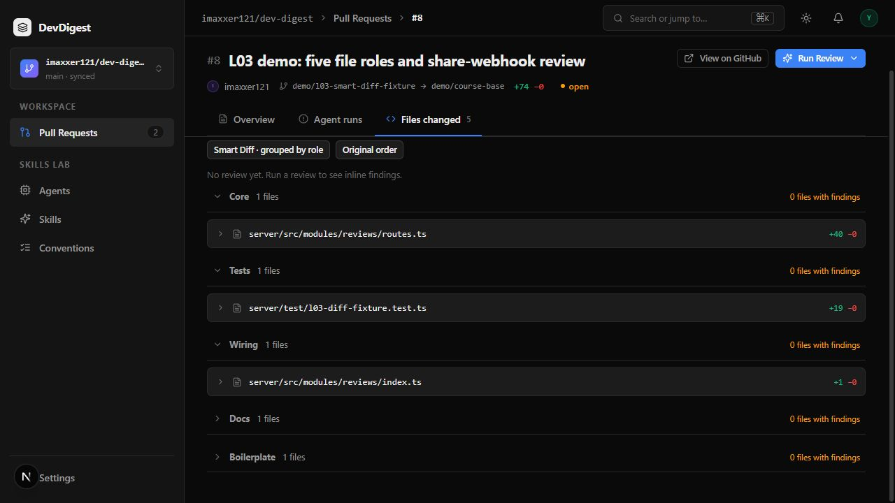
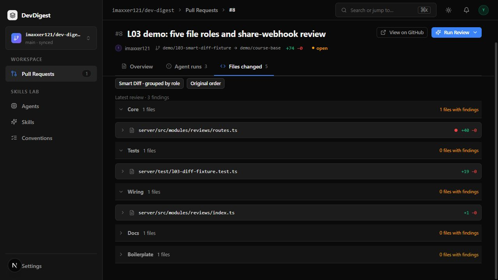
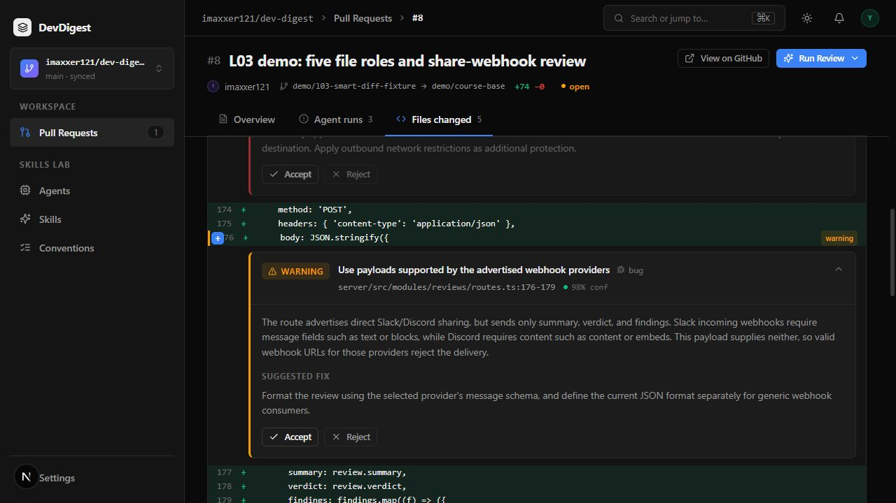
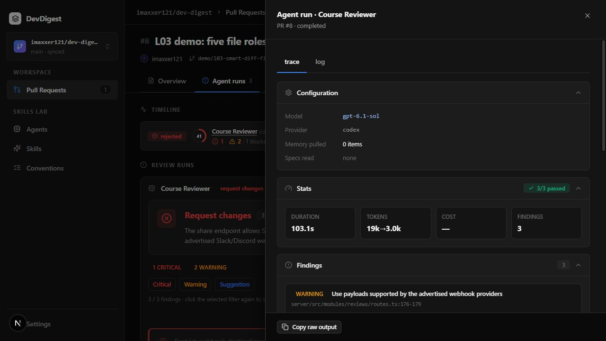

# L03 — Smart Diff

Files changed now groups real PR files as **core → tests → wiring → docs → boilerplate** before any model review. Docs and boilerplate start collapsed. A real review adds full inline FindingCards under their new-side start lines, finding dots, and counts of files with findings. Original order renders the untouched GitHub file array.

## Implementation

- Pure ordered rules in `server/src/modules/reviews/smart-diff/` classify paths. Boilerplate precedes tests, wiring, docs and the core fallback. The matrix includes snapshots under tests, `.claude` Markdown and an e2e README.
- `GET /pulls/:id/smart-diff` validates the ID and workspace, reads persisted files and the latest `kind=review`, and returns the shared five-role contract. A newer summary is excluded; a latest empty review clears old markers. Equal timestamps use an ID tie break. Both vendored contracts match.
- The existing reviews feed is also scoped by workspace, so inline cards and server markers agree even for a malformed cross-workspace database row.
- Shared diff components receive a finding renderer from the page. They do not import the page-local FindingCard. Actual parsed RIGHT line keys determine anchors; deleted rows cannot anchor new-side findings. Matching code rows have a severity-colored left stripe and a localized right label (Critical → blocker, Warning → warning, Suggestion → suggestion); multiple findings use the highest severity. Unmatched/binary findings appear once at the file end.
- Counts include accepted/dismissed findings and are independent of visibility. Human comment counts and finding dots are distinct. One Show/Hide comments switch controls both sources. Accept/Reject uses the existing persisted actions and refreshes both caches.
- The PR page observes completed runs while any tab is open. Continuous persisted-history polling also catches a run whose running state was missed between active polls. Path/side/line/reply-keyed draft state survives grouped/original remounts.

## Actual subagent pipeline

The user explicitly authorized these subagents in the current chat. These roles describe actual work in this session; they are separate from the Course Reviewer model run.

| Role | Actual work and result |
| --- | --- |
| planner | Read the project guides and produced `specs/l03-smart-diff.md`, including P1/P2 checks and ownership boundaries. No implementation code. |
| implementer | Implemented the client, contracts, interaction/cache regressions and client INSIGHTS. The primary implemented server code and integration tests. |
| architecture-reviewer | Independently inspected route/service/repository boundaries, contracts, renderer isolation, anchors and cache behavior. Found composer draft loss and missed fast background completion. Both were corrected with regressions. Final read-only review found no unresolved material issue. |
| plan-verifier | Independently compared the plan with code/tests. Found the reviews-feed workspace mismatch; it was corrected and the integration test now checks both endpoints. Independently ran 45 client interaction/hook tests and 41 server pure tests. |
| primary browser QA | Ran the real fixture through the app, checked persisted decisions and draft survival, and found missing severity text in compact badges. Inline cards now explicitly show Critical/Warning/Suggestion/Info labels; other card callers retain their compact default. Final rubric comparison also added the code-row stripe and localized right-side label, with a regression and narrow architecture re-review. |

An optional sticky role-header attempt conflicted with the existing sticky PR header and was removed. Role headers are accessible normal-flow accordions; **sticky role headers are not implemented**.

## Validation

Final checks on 2026-10-12:

| Command / evidence | Result |
| --- | --- |
| Server `pnpm typecheck` | Passed after the workspace-feed fix |
| Server `pnpm test` | **185/185**, 28 files, including PostgreSQL integration |
| New server Smart Diff coverage | 38 path cases + 3 pure grouping cases + 4 persisted integration cases |
| Client `pnpm typecheck` | Passed after the final severity-label change |
| Client `pnpm test` | **69/69**, 20 files; 23 additional tests relative to L02 |
| `git diff --check` | Passed |
| Smart Diff reads before inference | Three HTTP reads; run IDs remained `[]` before and after |

The tests cover interleaved original order/object identity, duplicate findings versus finding-bearing files, multiple hunks/LEFT-only numbers, CRLF/no-newline metadata, off-patch and missing patches, separate human threads, shared visibility, saved action states/errors, query invalidation, missed-running completion, and both new/reply drafts. Test fixtures and API mocks are distinct from the real model evidence below.

## Real run and browser evidence

The public [fixture PR #8](https://github.com/imaxxer121/dev-digest/pull/8) changes one file in each role. It preserves official share-webhook commit `658e5f2afa5035cc5eb7bf546f5e76d381bdaa5c` and its authorship; the route contains deliberate reviewable defects and is not intended for deployment. The added lockfile comment changes no dependency version.

- Base: `c3c804216fb4b954315c544280d68110ec1e5b05`.
- Head: `52a6fca9477bda8a6660a9a8dd74226342078253`.
- Actual run: `b9e1ba63-f4fb-4cea-b5c8-71a88d920b39`, Course Reviewer, `codex / gpt-6.1-sol`.
- Completed in **103,139 ms**, **18,562 input / 3,046 output tokens**, grounding **3/3 passed**, score 41. Dollar cost is **unknown/null**.
- Findings: Critical SSRF at RIGHT:173; Warning webhook payload compatibility at RIGHT:176; Warning ignored response at RIGHT:186.

The browser stayed on Files changed during completion and showed three findings with **one core file with findings** without reloading. Full cards were visibly anchored below the correct lines, with code-row stripes and blocker/warning labels. Accept and Reject persisted and survived a later reload. Hide/Show removed/restored cards and row markers without changing counts, and a typed new-comment draft survived grouped → original → grouped before being cancelled.

The runtime used the existing Codex CLI login without a Claude Code account or API key. The application trace's `review_file` label records its own single-pass step; it does not prove an inference-side tool call. No Claude comparison or model tool execution is claimed.

GitHub API access was offline for this local demo. Human-thread/reply/posting behavior and off-patch/binary fallback are covered by deterministic tests; no successful external comment posting is claimed. All three real findings were inside the shown patch.

Evidence: [no-inference](evidence/l03/no-inference.json), [real run](evidence/l03/real-review.json), [persisted decisions](evidence/l03/persisted-actions.json), [browser checks](evidence/l03/browser-checks.json).

## Demo

The demo is **110 seconds (1:50), H.264/MP4**, assembled from actual browser captures with captions. It is an **edited step-by-step walkthrough, not a continuous screencast**. Model waiting time is condensed; final traces show the actual duration and usage. The MP4 was decoded and played in the browser through a local byte-range preview. The native GitHub attachment is linked in the implementation PR description; a [repository copy](assets/l03/l03-smart-diff-demo.mp4) is also retained. The in-app browser could not play the GitHub CDN embed, so successful remote embedded playback is not claimed; the MP4 can be downloaded.

