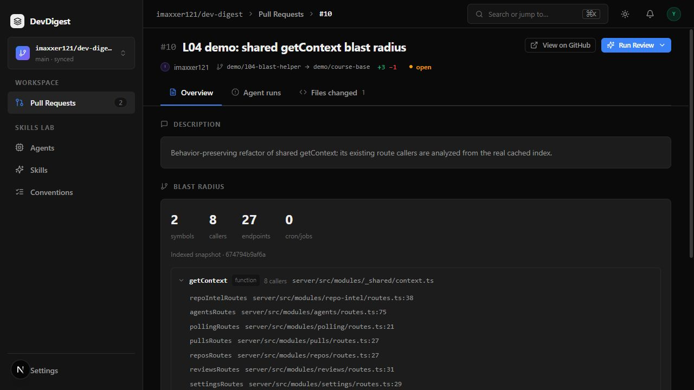
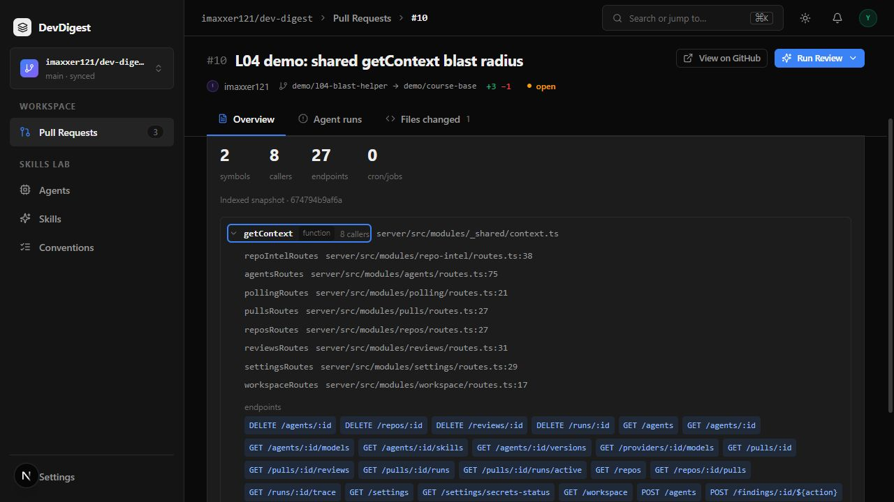
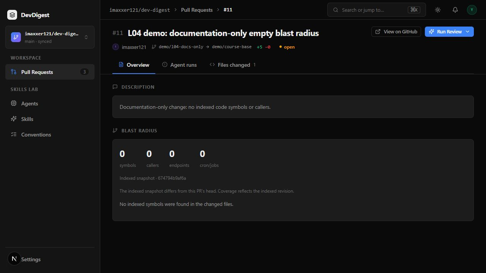
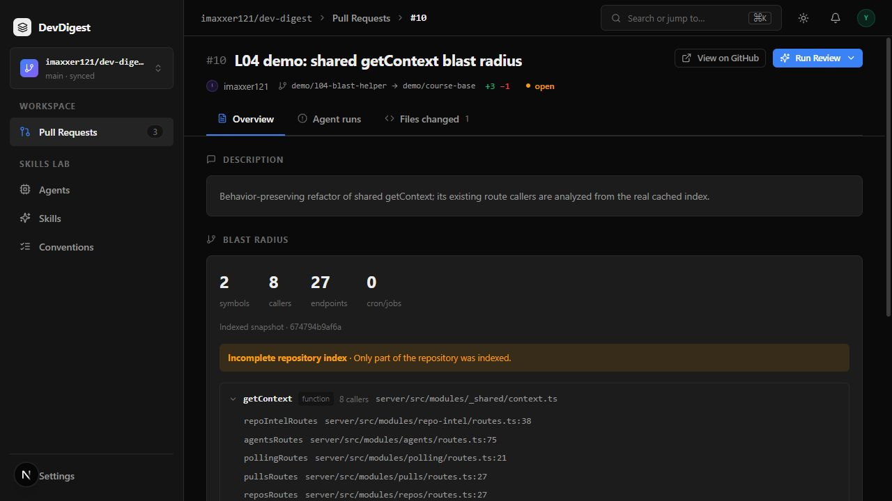
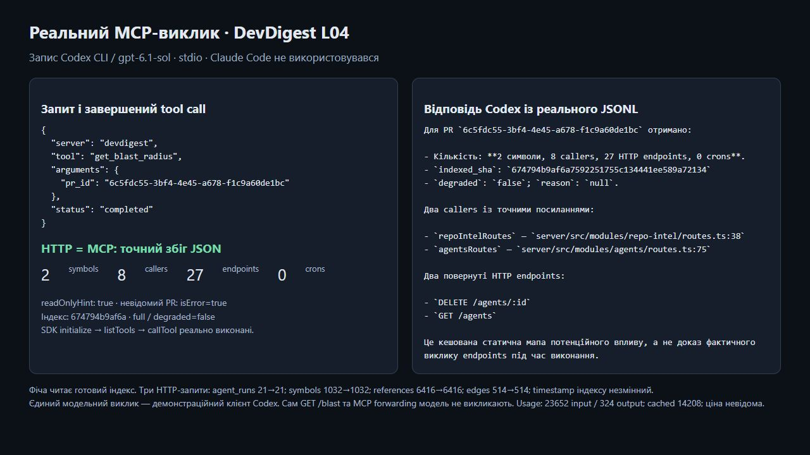

# L04 — Blast Radius

PR Overview now displays a cached impact map with changed symbols, real callers,
potential HTTP endpoints and separate cron/job impact. `get_blast_radius` returns
the identical validated HTTP document through MCP. Reads do not call a model,
parse source files or rebuild the import graph.

## Implementation

- `GET /pulls/:id/blast` validates the UUID, checks the PR's workspace and its
  parent repository's ownership, reads stored changed paths and calls the
  repo-intel facade once. A pure mapper groups by declaration `(file,name)`,
  excludes the declaration file, deduplicates callers and computes distinct
  global counts. Endpoints/crons are attributed to each group from its own
  caller facts. Both vendored Zod contracts match.
- The facade uses persisted index state, resolved references, symbol ranges,
  ranks, file facts and dependency edges. There is no clone/parser fallback on
  this read path. The existing constants govern the **20 callers per changed
  symbol** limit and **depth 2** potential-impact traversal. Partial data remains
  usable with `degraded=true` and `reason=index_partial`; missing, failed or
  disabled indexes receive explicit reasons.
- A real Windows index exposed a separator mismatch in dependency-cruiser:
  relative paths containing backslashes failed to match POSIX indexed files.
  Normalizing that adapter fixed missing edges/callers. A real adapter regression
  covers TS ESM `.js` imports. An equivalent source escape replaces an inherited
  literal NUL, and `.gitattributes` makes this source diff reviewable as text.
- The page-local client component preserves the PR description and renders
  server counts, accessible collapsible symbols, caller `file:line` links,
  HTTP chips, separate cron labels, loading/error/retry and clear empty states.
  Labels use `messages/en/blast.json`. GitHub links use **indexed_sha**, with
  coverage text when it differs from PR head; absent SHA yields a plain label.
- The independent `devdigest-mcp` package contains one tool, not the earlier
  lab's full tool catalogue. Its SDK stdio registration sets
  `readOnlyHint:true`, validates local UUID input and the backend document,
  bounds HTTP waits and preserves the exact response in structured/text content.
  It does not accept arbitrary destination URLs or include API keys.
  [Setup and real-process verifier](../devdigest-mcp/README.md).

The actual traversal enumerates **direct resolved-symbol callers**, then follows
**one reverse cached file-import hop** for potential endpoint/cron facts. It does
not enumerate second-hop symbol callers. Symbols are declarations in changed
files, not a semantic diff of which individual declarations changed. File facts
describe potential impact, not exact runtime invocation; dynamic route templates
may remain unresolved strings, such as `POST /findings/:id/${action}`.

## Actual subagent pipeline

The user authorized the same pipeline used for L03. These roles describe actual
work in this chat, separately from the real Codex CLI MCP demonstration.

| Role | Actual contribution |
| --- | --- |
| planner | Read the task and repository guides; produced `specs/l04-blast-radius.md` with the contract, acceptance checks and client handoff. |
| implementer | Implemented the client component, hook, localization, refresh invalidation, eight new UI cases and client INSIGHTS. Ran the full client suite and typecheck. |
| architecture-reviewer | Independently reviewed boundaries, workspace ownership, attribution, DTO/MCP and UI. Found invalid MCP JSON could be accepted and enclosing caller selection could ignore endLine. Both were fixed with regressions. Identified the existing non-atomic reindex limitation. |
| plan-verifier | Independently compared the plan with implementation and reproduced the two concrete issues above. Ran focused mapping/cache/DB/MCP/UI checks and checked contracts/whitespace. |
| primary | Implemented server and MCP, fixed reviewer findings and Windows indexing, ran final server/MCP checks, indexed public fixtures, checked browser links/states, performed actual SDK and Codex MCP calls, and prepared evidence/demo. |

The read-only reviews left no unresolved P1 implementation blocker. Their checks
did not establish Claude Code access, mentor acceptance or final submission.

## Verification

Final checks on 2026-10-12:

| Command / evidence | Observed result |
| --- | --- |
| Server `pnpm typecheck` | Passed |
| Server `pnpm test` | **197/197**, 32 files, including PostgreSQL integration |
| New server tests | 4 pure mapping + 5 cache/traversal + 2 workspace/API integration + 1 real dependency-cruiser case |
| Client `pnpm typecheck` / `pnpm test` | Passed; **77/77**, 21 files; 8 new Blast Radius cases |
| MCP `npm run typecheck`, `npm test`, `npm run build` | Passed; **5/5**, one source test file |
| MCP `npm audit --omit=dev` | 0 production vulnerabilities in this new package |
| Both shared contract copies / `git diff --check` | Identical / passed |
| Actual SDK stdio | initialize, listTools and callTool succeeded; HTTP = MCP structured JSON = MCP text JSON |
| Unknown local PR UUID through MCP | Useful `isError:true`; no invented empty success |

Tests cover same-named declarations in different files, per-group facts, global
distinct counts, missing facts, full/partial/failed/no-data/flag-off states,
per-root limits, reverse edges/cycles/depth, top-level reference ranges, foreign
PR and parent-repository ownership, invalid IDs, SHA links and response failures.
Parser/Git/provider spies guard cache-only reads. Tests and controlled
fixtures are separate from the real evidence below; reviewer-core was not rerun.

## Real fixtures and source checks

The [helper fixture PR #10](https://github.com/imaxxer121/dev-digest/pull/10)
changes the real exported `getContext` in `server/src/modules/_shared/context.ts`.
Existing route consumers are unmodified. Its actual head is
`674794b9af6a7592251755c134441ee589a72134`, base
`c3c804216fb4b954315c544280d68110ec1e5b05`, local PR UUID
`6c5fdc55-3bf4-4e45-a678-f1c9a60de1bc`.

A normal preparatory index completed **full**, **312 files**, **0 skipped**, in
**2,688 ms** (persisted internal duration 2,686 ms). Cached rows: **1,032 symbols,
6,416 references, 514 edges**. The HTTP/UI/MCP map agrees on **2 symbols,
8 callers, 27 potential endpoints, 0 crons**, `degraded=false`, `reason=null`.
`RequestContext` has no captured external callers; the UI says so explicitly.

Two actual caller links were clicked in the UI and their GitHub source checked:

- [pulls/routes.ts:27](https://github.com/imaxxer121/dev-digest/blob/674794b9af6a7592251755c134441ee589a72134/server/src/modules/pulls/routes.ts#L27)
  imports and calls `getContext`, including the real `GET /pulls/:id` route.
- [repos/routes.ts:27](https://github.com/imaxxer121/dev-digest/blob/674794b9af6a7592251755c134441ee589a72134/server/src/modules/repos/routes.ts#L27)
  imports and calls `getContext`, including `GET /repos`.

The [documentation-only PR #11](https://github.com/imaxxer121/dev-digest/pull/11)
changes `docs/l04-no-callers.md`; its local UUID is
`7c44fd3b-8c6d-4f17-9136-7bdd4a2ce203`. It returns four zero counts and the clear
no-indexed-code state. Its head differs from the cached helper snapshot; the UI
shows that coverage difference rather than silently using the PR SHA for links.

The partial-index demonstration is a **controlled status fixture**: only the
persisted status was temporarily changed to partial; real symbols/callers were
untouched. The route/UI preserved 2/8/27/0 and displayed `index_partial`. The
original full state was restored. This is not evidence of a natural index failure.

Three actual HTTP reads left **agent_runs 21→21**, symbol/reference/edge counts
unchanged, and index timestamp/SHA unchanged. Together with forbidden-I/O tests,
this supports the cache-only path. The route logs identify `persisted-repo-intel`
and include PR/repo/counts/status without source text or credentials.

Evidence: [index](evidence/l04/real-index.json),
[unchanged records](evidence/l04/no-inference.json),
[MCP parity](evidence/l04/mcp-parity.json),
[controlled partial](evidence/l04/controlled-partial-state.json),
[actual cache-read log](evidence/l04/cache-read.log.txt),
[browser checks](evidence/l04/browser-checks.json).

## Actual agent-client MCP call and course exception

**Claude Code and its API access were unavailable.** Instead, the existing
subscription-backed **Codex CLI / gpt-6.1-sol** executed one actual
`devdigest.get_blast_radius` tool call over stdio for the same PR. Its completed
JSONL event has no tool error; the returned document exactly matches HTTP and
the SDK result. The model's answer reports 2/8/27/0, two real caller lines, two
returned endpoints, the indexed SHA and the static-impact limitation.

Actual usage: **23,652 input**, **14,208 cached input**, **324 output tokens**;
dollar cost is unknown/null. That inference belongs to the demonstration client;
the map feature and MCP forwarder do not themselves call a model.
[Recorded actual call, answer and usage](evidence/l04/real-codex-mcp.json).
The evidence screen in the video renders this recorded JSONL; it is not a fake
interactive Claude/Codex window.

The literal rubric step “invoke in Claude Code” remains **substituted, not
verified**. Mentor acceptance of this alternative is not guaranteed. The tool's
protocol, real-process operation and response parity are demonstrated without a
model API key; a later Claude run can use the supplied project configuration.

## Demo and limits

The [repository MP4](assets/l04/l04-blast-radius-demo.mp4) is **107 seconds
(1:47)**, H.264/AAC, 1280×720, with faststart. It is an **edited walkthrough of
actual browser captures**, not a continuous screencast. It shows Overview counts,
callers/endpoints, two inspected GitHub caller lines, collapse, the empty PR,
the controlled partial reason and recorded real MCP evidence. The file passed
full decoding and local browser playback. [Timeline and media checks](evidence/l04/video.json).

The existing indexer replaces cached tables separately and stamps state last;
reads concurrent with reindexing can mix rows and the previous SHA. This work
does not claim atomic/versioned snapshots. All real demonstrations ran after
index completion. No UI forced-resync button was added. Optional Tree/Graph,
prior-PR history and changed-symbol rank ordering were not implemented;
collapsible groups, separate crons and localized labels were implemented.

