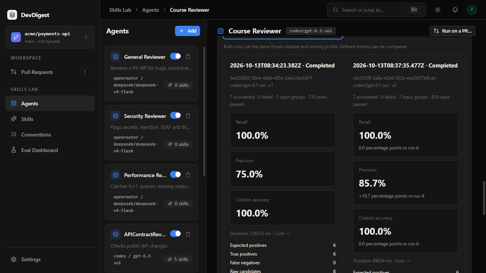
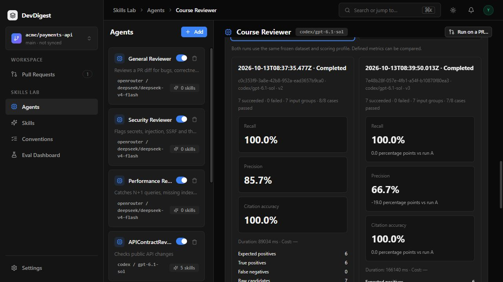

# L06 — Eval pipeline

Accepted and dismissed review findings now become immutable regression cases.
FindingCard has a **Turn into eval case** action; AgentEditor **Evals** lists
cases, starts a stored batch and compares completed runs. The sidebar **Eval
Dashboard** shows latest and recent runs. Opening any history/dashboard view
reads persisted data and does not invoke a model.

## Run locally

Install dependencies in the independent `server`, `client` and `reviewer-core`
packages. Start PostgreSQL with pgvector, apply migrations with `pnpm db:migrate`
in `server`, configure an existing provider and start API/client on 3001/3000.
Use one API instance per database: startup marks preexisting active batches
interrupted and never silently reruns inference.

Convert a decided finding, open its agent's Evals tab, and select **Run all evals**.
The API snapshots all cases, model, system prompt and enabled ordered skill
bodies before background generation. Identical frozen inputs share one model
call. Only explicit POST actions generate predictions; expectations and prior
answers are never included in model messages. Runtime bounds are 128 cases,
32 groups, 16 MiB per snapshot and 64 KiB per frozen file fragment.

Run `pnpm verify:l06` from the checkout root. Docker is mandatory for the
isolated real PostgreSQL suite; missing Docker or skipped DB tests fails the
command. Verification checks mirrored Zod contracts, three package typechecks
and deterministic server/client/core tests. It makes no model calls.

## What the metrics mean

The scorer is pure code. A predicted finding matches a positive expectation
when its file is exactly equal and its line range overlaps. Maximum one-to-one
matching prevents duplicate credit. Every raw candidate stays in precision,
including duplicate, unmatched and ungrounded findings. Negative expectations
forbid overlapping findings at the dismissed location.

Recall is TP / expected positives; precision is TP / raw findings; citation
accuracy is grounded / raw findings. Aggregate counts are summed once per
unique input group. Zero denominators and failed/partial overall ratios are
null, displayed as `—` with a reason. Cost stays unknown when the provider does
not supply pricing. Comparison deltas require two completed distinct runs with
the same dataset/profile/scorer/grounding comparison key.

These are positional regression metrics for a finite curated rubric. They do
not judge whether every reported vulnerability is semantically correct. Valid
unlabelled findings can count as false positives; valid UI/performance findings
can be intentionally outside a security-only rubric.

## Evidence and methodology

The pre-code spec and implementation plan were committed at `4d4085b` before
implementation. The course asks for Claude Code; access was unavailable, so
the SDD workflow and actual inference use Codex. No Claude execution or manual
authorship is claimed. Specification, planner, implementer, architecture review
and plan verification were performed by the recorded agents in this chat.

The experiment uses eight authentic saved findings from earlier actual Codex
reviews: six `must_find`, two `must_not_flag`, seven unique frozen inputs. The
two negatives exclude keyboard behavior and query efficiency from the security
rubric; their dismissal does not assert factual falsehood. Historical source
head SHA is unknown, while the exact source-review diff and IDs are retained.

Before any eval inference, an initially selected special `lethal_trifecta`
finding was rejected as unsupported. It was replaced with an authentic normal
XSS finding, and both selections were preserved. The suite and three prompts
were fixed before generation. No expectation was edited after observing output.

The first genuine batch was interrupted after two groups when an old route
smoke test inherited the working database URL and ran startup recovery. Its
failed history and null aggregate metrics are preserved. Smoke tests now use
an isolated no-I/O DB; test app startup requires an explicitly injected DB.
The original prompt was rerun against the same suite.

Actual snapshots, raw outputs, prompt assemblies, source IDs, digests, counts,
nullable cost and complete/failed history are in [evidence/l06](evidence/l06/).
The three completed runs used `codex/gpt-6.1-sol`, no linked skills, the same
dataset digest `f4a6960390a3fc3070969eff04d69bc42d1ce316a386a112e6b533a51723fa42`
and comparison key `e09a6efaeced7e098528a89177b8992bee4e00d378c4315777ecddbe67fbf0ef`.

| Prompt / batch | TP / raw | Recall | Precision | Citation accuracy | Cases passed |
| --- | --- | --- | --- | --- | --- |
| Original v1 · `9ed20862-50c4-4dab-bf3e-2e4cc6acb97f` | 6 / 8 | 100% | 75.0% | 100% | 7/8 |
| Improved v2 · `c0c353f9-3a8e-42b8-952a-ead3657b9ca0` | 6 / 7 | 100% | 85.7% | 100% | 8/8 |
| Deliberately bad v3 · `7e48b28f-057e-4fb1-a54f-b10870f80ea3` | 6 / 9 | 100% | 66.7% | 100% | 7/8 |

Precision moved +10.7 percentage points with the focused prompt, then −19.0
points with the verbose style prompt. The improved prompt excluded the
out-of-rubric query-efficiency finding; the bad prompt produced additional
UI/performance candidates. An extra real SSRF issue is unlabelled and counts
as a false positive in all three runs. This is a rubric limitation, not a
claim that the extra SSRF is invalid. Current agent configuration was restored
to the improved prompt (v4); the bad-run snapshot remains v3.

Each complete batch made seven grouped generation calls, without scoring
calls. The earlier interrupted batch `6efee98a-9f51-4d9e-a6c4-b302c7b98415`
is included separately with null aggregate ratios. One run per prompt on
eight curated cases is a sensitivity demonstration, not a statistical claim
of general model quality.

Final `pnpm verify:l06`: **203 server unit, 38 real PostgreSQL, 119 client,
23 reviewer-core tests passed**; all three typechecks and mirror parity passed.
The Next production build passed. [Saved output](evidence/l06/verification.txt).

[Narrated end-to-end video](assets/l06-eval-pipeline-demo.mp4).

The required narrated video uses edited captures of the actual browser flow,
with model waiting compressed and disclosed synthetic Russian narration.
It does not claim to be a continuous recording or the user's own voice.
